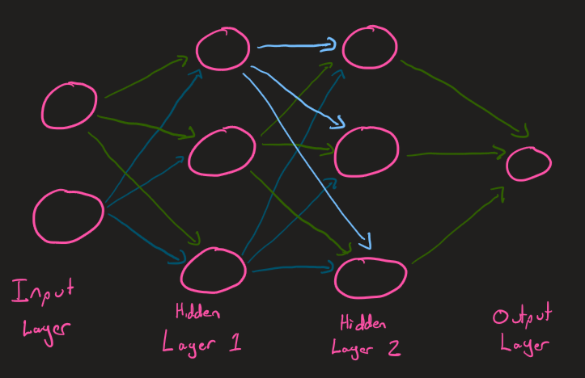
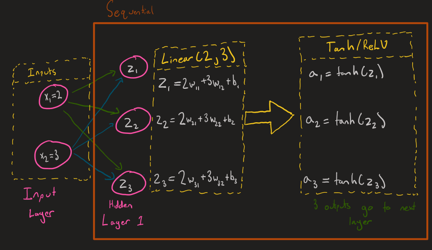
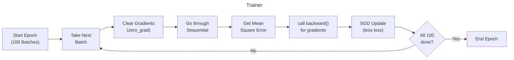

# rahml: a small neural network library in C++20

**CS246E Self-Proposed Project** | **Ryan Howe**

## Description of the project

I want to build a small C++ library that lets someone put together and train a fully connected neural network. The library will calculate the derivatives needed for training, so the person using it can focus on the model and the data. It will mainly do math with doubles and run on a CPU.  `make` will build it.

*Basically you can think of this as just some function that takes in 2 inputs and returns one output. The pink circles in my drawing are called neurons. The arrows carry numbers between them. A circle in the input layer just holds some number (the input); each neuron in the later layers has one "weight" for each incoming arrow and one "bias".*

For the first hidden layer in my drawing, each of its three neurons receives both inputs. A `Linear(2, 3)` module owns two weights and one bias for each neuron and calculates three weighted sums ($z_i$). For inputs 2 and 3, one neuron might calculate `z = 2*w1 + 3*w2 + b`. A separate `Tanh` module (we have these as seperate because someone may want to swap it for `ReLU`) applies `tanh` to each of the three sums, producing three outputs between -1 and 1. It has no weights of its own. `Sequential` stores these modules in order and passes each module’s outputs to the next. For my first drawing, the order could be `Linear(2, 3)`, `Tanh`, `Linear(3, 3)`, `Tanh`, then `Linear(3, 1)`. The final number is the prediction. As you can see `Sequential` is basically this vector that has a bunch of different types of in it.

The modules do their calculations using smaller `Value` objects for inputs, weights, biases, and intermediate results. Each operation records which values produced its result. These links form a computation graph. Mean squared error compares the prediction with the desired answer and produces one loss `Value`. Calling `backward()` on that loss follows the graph backward and calculates how much each weight and bias affected the loss.

To train the model, a `Trainer` will work through small batches of examples. For each batch it clears the old gradients, makes predictions, calculates the average loss, calls `backward()`, and updates the parameters. SGD (stochastic gradient descent) moves each parameter a small distance opposite its gradient (to try to make a better prediction on the next round). Momentum SGD also keeps a separate record of recent update directions (another option to regular SGD that may make it faster to train). The trainer will shuffle examples and report progress.

Someone can use the framework by writing and compiling a C++ program that builds a model and calls the trainer. I will also include ready-made terminal demos. The first will calculate `(x+y)*y` for chosen values of `x` and `y` and print its result and derivatives. This checks the `Value` graph against an answer we can calculate by hand. A regression demo will train on `y = 2x + 1` to show that the model can learn a linear pattern. A XOR demo will test the hidden layers and activations as a single linear layer cannot classify all four XOR inputs correctly. The library will also include CSV loading, saving and loading weights (giving the strong exception guarantee when loading by parsing all weights into a temporary buffer before committing them, so a failed load never leaves the model with half-updated weights), and numerical gradient checks (basically a utility module for me to check that I am correctly doing `backward()`). A second C++ client will show that it works outside my demo program.

For the November 20 milestone, `make` will build a small terminal program that accepts `x` and `y`, calculates `(x+y)*y` using `Value` objects, and prints the result and the gradients found by `backward()`. Changing the inputs will change the printed results. This will show a working start to the automatic differentiation engine.

## Abstraction problems and C++ design

The first abstraction problem is managing lifetimes in the computation graph. Model weights and biases must survive across training steps, while the weighted sums, activations, and loss created for one batch are only needed through its backward pass. Multiple calculations may also depend on the same value. I plan for Value to be a small handle holding a `std::shared_ptr<Node>`. This lets me define arithmetic on a type I control while hiding the graph’s ownership details from users. The node stores the number, its gradient, and links to the input nodes used to create it. Copying a Value shares that node rather than copying the graph, so gradient contributions from different paths accumulate in the same place (also deep copy would be terrible for memory). Result nodes keep their inputs alive, while layers keep their weight and bias nodes alive across batches. During an expression like `(w1 * x1) + b`, sub-expressions return temporary rvalue `Value` handles that link the underlying heap `Node`s (leaving basically just the end term to be lvalue `Value`). Once the final `loss` handle goes out of scope at the end of a batch, its reference count drops to zero and triggers a chain reaction that frees all intermediate nodes (given the client doesn't also have a handle to any), stopping at the weights and biases still held by the layers. Another option is to have some sort of vector that holds a `unique_ptr` to all the weight/bias nodes and one for all the others (more efficient because `shared_ptr` adds overhead). All the `Node`s then would just have non-owning ptrs to the ones that created them. I think this would make it more messy though because now if a client wanted to make a copy of an intermediate step, then that node at the end would contain dangling pointers. The other problem is we wouldn't know if a client wanted their `Value` to be a weight/bias or other. The one other bad thing is how we would push onto the vectors (we would either need a global or pass it into every +, -, *, / operation).

The network layers have a different ownership problem: a `Sequential` model needs to hold different kinds of modules, including `Linear`, activations (like `tanh`), and possibly another `Sequential` (this is like the same problem we are on right now in class). I plan to give them a common `Module` interface and let the sequence own its modules through `unique_ptr`. A templated `emplace<Linear>(...)` method can construct a module from its arguments and insert it (I'll use variadic templates for this and perfect forwarding). Each module can report its parameters (for `Tanh` this would just be empty vector). A sequence will collect them from its children without listing a shared weight twice (I will use `unordered_set` for this). This makes it possible to add another kind of module without rewriting the trainer (as it will just need to have a forward and parameters method). The sequence will be movable, but copying a whole model will not silently duplicate or share its trainable weights (I will just delete the copy constructor).

This ownership choice has to support a computation graph that is not necessarily a tree. If `a = x*x` and `z = a*x + a`, then `x` is used several times and `a` branches into two later calculations. The backward pass must add every path to the same gradient, while processing each result after all of its downstream contributions have arrived. I plan to collect nodes in topological order and traverse them backward. Each operation will save the local effect of each input on its result. For multiplication, these local derivatives are the other operand (ex. in z = x * y, dz/dx is just the other operand y). Saving them uses extra memory, but lets one graph traversal apply the chain rule without a separate backward algorithm for each operation. I am still not certain if I will do this though (I think saving the memory might be nice although it is just a double).

I will also use the exception-safety ideas from class. A layer will reject the wrong number of inputs. CSV rows and checkpoint files (just files that save weights/biases) will be checked before they change a model. An invalid checkpoint should leave all existing weights unchanged (strong guarantee). Constructing a new module before inserting it should leave the sequence intact if construction fails (as potentially someone could create a derived class that throws). These choices involve constructors, constness, RAII, smart pointers, moves, and templates.

I think the scope is comparable to the provided projects because the graph, module hierarchy, trainer, file handling, and independent client have to work together as one reusable system. The C++ ownership and interface choices are a substantial part of the work, in addition to getting the math right.

## Proposed marking scheme
I will have a `make test` target that compiles and runs small C++ checks against expected answers. The larger training examples will have terminal commands, so a marker can run them during the demo. A marker could also compile a small program using the public library interface to check an operation or model of their own (I will give documentation on how to use, and I can also walk the marker through writing a program). Floating-point checks will use some tolerance (say 0.01).

### Values and operations (isolated tests) (10 marks)

| # | Grading Item |
|---|---|
| 1 | Construct constant and tracked `Value` objects; display their data and initial gradients. |
| 2 | Addition gives the expected value and both input gradients in a small hand-calculated case. |
| 3 | Subtraction gives the expected value and both input gradients. |
| 4 | Multiplication gives the expected value and both input gradients. |
| 5 | Division by a nonzero value gives the expected value and both input gradients. |
| 6 | Unary minus gives the expected value and gradient. |
| 7 | Squaring gives correct values and gradients for positive and negative inputs. |
| 8 | `tanh` gives the expected value and gradient within tolerance. |
| 9 | `ReLU` gives correct values and gradients for negative, zero, and positive inputs. |
| 10 | Number literals work on either side of an operation, including `2*x`,`x*2`,`x/2`,`2/x`. |

### Graph and backward pass (integrated tests) (10 marks)

| # | Grading Item |
|---|---|
| 11 | `(x+y)*y` at `x=2, y=3` gives value 15 and gradients 3 and 8. |
| 12 | `x*x` at `x=3` counts both input edges and gives gradient 6. |
| 13 | `a=x*x; z=a+a` at `x=3` gives gradient 12 for `x`. |
| 14 | `a=x*x; z=a*x+a` at `x=2` gives gradient 16 for `x`. |
| 15 | A detached copy keeps the number but stops one gradient path: `detach(x)*x` at 3 gives gradient 3. |
| 16 | After changing a parameter from 2 to 3, a new graph for `x*x` changes its gradient from 4 to 6. |
| 17 | Calling `backward()` twice on the same graph replaces its gradients instead of doubling them. |
| 18 | A numerical gradient check agrees with backpropagation for a composed scalar expression (this involves creating the numerical gradient check utility as well). |
| 19 | Numerical checks agree for every parameter in a small network; original weights are restored even if checking fails (as we have to slightly modify weights, and exception could throw). |
| 20 | A text graph trace shows values, operations, gradients, and shared input nodes. |

### Modules (10 marks)

| # | Grading Item |
|---|---|
| 21 | A `Linear` layer with several inputs and outputs matches hand-calculated outputs. |
| 22 | Backpropagation through `Linear` matches hand-calculated weight gradients. |
| 23 | Backpropagation through `Linear` matches hand-calculated bias gradients. |
| 24 | A `ReLU` module applies to every entry of an input vector and gives the expected gradients. |
| 25 | A `Tanh` module applies to every entry of an input vector and gives the expected gradients. |
| 26 | `Sequential` gives the same output as calling its layers one by one. |
| 27 | A `Sequential` nested inside another sequence gives the same output as the unnested version. |
| 28 | Recursive (because there could be nested `Sequential`) parameter collection reports a shared parameter only once (I am not double counting). |
| 29 | Supplying the wrong number of inputs to a layer gives a clear size error. |
| 30 | A separate client defines and inserts an elementwise-square module without changing the graph engine or trainer. |

### Loss and training (testing the actual training loop) (10 marks)

| # | Grading Item |
|---|---|
| 31 | Mean squared error over multiple outputs agrees with a hand calculation. |
| 32 | The mean squared error graph gives the expected prediction gradients. |
| 33 | One SGD (Stochastic Gradient Descent) step matches `weight -= learning_rate * gradient` for known numbers. |
| 34 | Gradient reset clears every model parameter, including parameters that weren't used in the loss on the previous iteration. |
| 35 | Two momentum SGD steps match hand-calculated velocity and parameter changes (momentum is remembering and taking into account gradients from previous run). |
| 36 | A batch's mean-loss gradient equals the average of separately calculated example gradients. |
| 37 | A last batch smaller than the chosen batch size is used and averaged by its actual size. |
| 38 | Shuffling uses every example once per epoch and repeats its order with the same seed. |
| 39 | Terminal options set epochs, learning rate, batch size, seed, and optimizer. |
| 40 | Reported epoch loss correctly weights batches of different sizes (won't be used to update, this is essentially a display metric). |

### Data and complete demonstrations (10 marks)

| # | Grading Item |
|---|---|
| 41 | Load a headerless numeric CSV with chosen input and target column counts. |
| 42 | Reject a nonnumeric field or wrong column count and report the row. |
| 43 | Save weights, start a fresh process, load into the same model shape, and reproduce predictions. |
| 44 | Reject a malformed checkpoint without changing any existing weight. |
| 45 | Train on `y=2x+1` data to mean squared error below `0.001` with a documented configuration (so the configuration is enough that it will actually train the network). |
| 46 | Load that trained model and predict outputs for new input rows. |
| 47 | Train a `2 -> 8 -> 1` tanh model on XOR (-1 for matching inputs and 1 for different): all four output signs correct and mean squared error below `0.05`. |
| 48 | Print a labelled grid of the XOR model's predictions over two-dimensional inputs. |
| 49 | Change the hidden-layer width through a terminal option without changing library code. |
| 50 | Compile a second C++ client using the library and train a two-output regression model (eg. predict both $y_1 = x_1 + x_2$ and $y_2 = x_1 - x_2$). |

## Past projects and resources

I took part in [ICPC edge-cloud scheduling competition](https://codeforces.com/contest/2251/problem/A). That was about deciding where to run model requests. Here I want to build the tools for defining and training a small model which is quite different. This was the thing that inspired me to do this project.

I coded along with the first lesson of [Andrej Karpathy's Zero to Hero course](https://karpathy.ai/zero-to-hero.html), which helped me understand backpropagation and come up with this idea. It is all in python and was for background so I would not submit any of that code. Some other references I was planning to use are the [PyTorch documentation](https://docs.pytorch.org/docs/2.15/index.html) (to do a similar API), [3Blue1Brown's neural-network lessons](https://www.3blue1brown.com/?topic=neural-networks) (I have watch all of these, but it will be good theory for me to reference), and [Stanford CS336](https://cs336.stanford.edu/) (for optimizer ideas like AdamW, or as a stretch reference if I extend the engine from scalars to 2D tensors to train larger models as extra).
